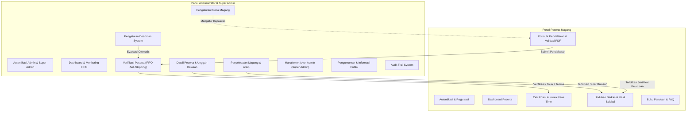
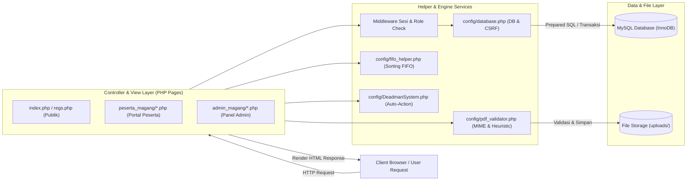
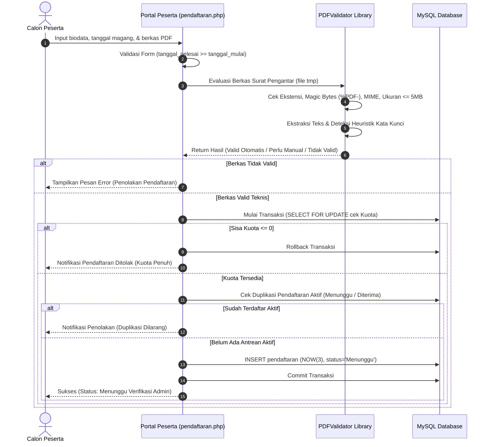
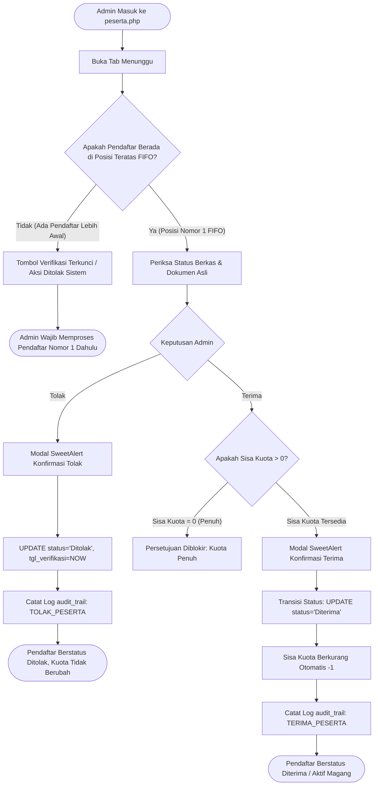
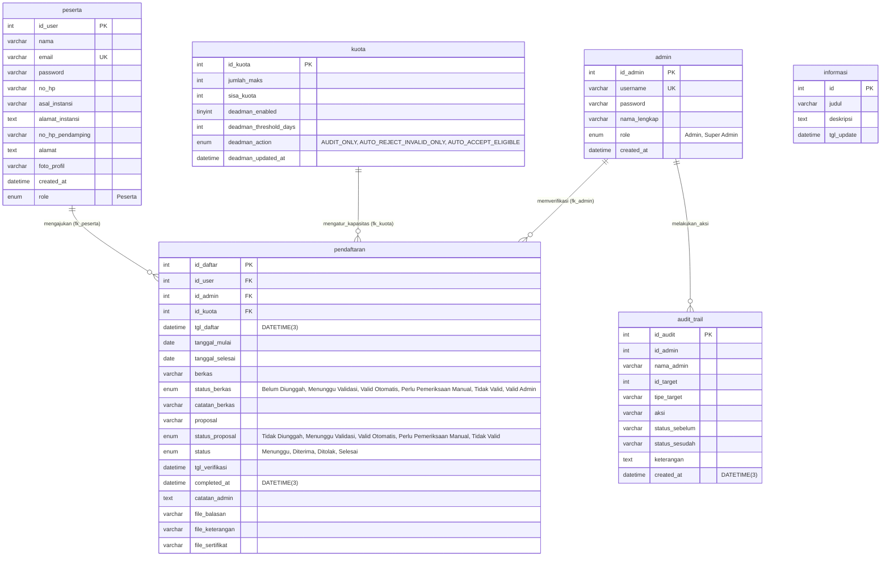

# Sistem Informasi Manajemen Penerimaan Magang — Balai Tekkomdik DIY

Aplikasi web berbasis **PHP Native** dan **MySQL** yang dirancang untuk mengelola seluruh siklus penerimaan, penyeleksian, pemantauan, dan penyelesaian kegiatan magang/Praktik Kerja Lapangan (PKL) di **Balai Teknologi Komunikasi Pendidikan (BTKP) Daerah Istimewa Yogyakarta**.

Sistem ini menerapkan algoritma penyeleksian antrean **First-In, First-Out (FIFO) multi-periode**, kalkulasi kapasitas kuota dinamis dengan proteksi transaksi atomik (*pessimistic locking*), pemindaian heuristik berkas dokumen persyaratan PDF, otomasi pemrosesan pengajuan kedaluwarsa (*Deadman System*), serta pencatatan audit trail berbasis waktu berpresisi milidetik.

---

## Daftar Isi
1. [Ringkasan Project](#ringkasan-project)
2. [Fitur dan Modul](#fitur-dan-modul)
3. [Teknologi yang Digunakan](#teknologi-yang-digunakan)
4. [Struktur Direktori](#struktur-direktori)
5. [Arsitektur dan Alur Sistem](#arsitektur-dan-alur-sistem)
6. [Proses Bisnis](#proses-bisnis)
7. [Skema Basis Data](#skema-basis-data)
8. [Panduan Instalasi & Konfigurasi](#panduan-instalasi--konfigurasi)
9. [Manajemen Akun dan Hak Akses](#manajemen-akun-dan-hak-akses)
10. [Pengujian dan Quality Assurance (QA)](#pengujian-dan-quality-assurance-qa)
11. [Keamanan dan Keterbatasan](#keamanan-dan-keterbatasan)
12. [Troubleshooting](#troubleshooting)
13. [Status Dokumentasi](#status-dokumentasi)

---

## Ringkasan Project

### A. Latar Belakang & Permasalahan yang Diselesaikan
Proses penerimaan magang institusi pemerintah sering kali menghadapi tantangan operasional:
- **Ketidakpastian Antrean & Potensi Bias:** Tanpa aturan seleksi yang ketat, pendaftar yang mendaftar lebih lambat berpotensi diproses mendahului pendaftar yang telah menunggu lebih awal.
- **Kondisi Balapan Kuota (*Race Condition*):** Banyaknya pendaftar yang mengajukan formulir secara serentak berisiko mengakibatkan kuota terisi melebihi kapasitas fisik institusi (*overbooking*).
- **Pengunggahan Dokumen Tidak Valid:** Pendaftar kerap mengunggah berkas yang salah (misal: modul kuliah, slide presentasi, atau gambar yang diubah ekstensinya menjadi `.pdf`).
- **Pendaftar Terbengkalai Tanpa Keputusan:** Pengajuan yang tidak segera ditindaklanjuti admin memakan slot kuota harapan dan merugikan calon peserta.
- **Kurangnya Transparansi Publik:** Calon peserta tidak dapat mengetahui posisi antrean seleksi mereka tanpa menghubungi staf administrasi secara manual.

### B. Solusi yang Diterapkan
Sistem Informasi ini menyelesaikan permasalahan di atas dengan:
1. **Algoritma FIFO Multi-Periode Deterministik:** Urutan antrean pendaftar diatur secara adil berdasarkan prioritas tanggal mulai magang, tanggal selesai, waktu submit milidetik (`NOW(3)`), dan tie-breaker ID unik. Aksi verifikasi admin divalidasi oleh sistem agar tidak melompati antrean (*anti-skipping*).
2. **Proteksi Kuota Transaksional:** Menggunakan transaksi basis data dengan penguncian baris (`SELECT ... FOR UPDATE`) untuk menjamin konsistensi kuota saat terjadi konkurensi request tinggi.
3. **Pustaka Pemindai Berkas `PDFValidator`:** Memverifikasi integritas fisik berkas PDF (MIME type riil via `fileinfo` dan *magic bytes* header `%PDF-`) serta memindai teks internal menggunakan algoritma heuristik untuk membedakan surat pengantar resmi dari modul/sertifikat.
4. **Deadman System Automation:** Skrip worker mandiri yang memantau pengajuan yang tertahan (*idle*) melebihi batas toleransi hari (default 7 hari) untuk diberikan rekomendasi tindakan atau diproses otomatis sesuai kebijakan.
5. **Transparansi Posisi Kuota (Data Minimization):** Halaman publik peserta yang menampilkan posisi antrean dan widget kuota real-time tanpa membocorkan identitas pribadi pendaftar lain.

### C. Aktor Pengguna Sistem
1. **Calon Peserta Magang:** Melakukan registrasi akun, melengkapi biodata, mengunggah dokumen persyaratan, memantau posisi antrean seleksi, dan mengunduh berkas surat balasan resmi serta sertifikat kelulusan.
2. **Administrator Magang:** Memverifikasi berkas pendaftar sesuai urutan antrean FIFO, menyetujui/menolak pengajuan, mengunggah surat balasan, mengelola pengumuman, dan menyelesaikan periode magang peserta aktif.
3. **Super Administrator:** Memegang hak administratif tertinggi, mengelola konfigurasi kuota global, mengatur kebijakan Deadman System, serta mengelola akun dan hak akses administrator lain.

---

## Fitur dan Modul

Sistem terdiri dari **14 modul utama** yang terimplementasi secara penuh:



### 1. Modul Autentikasi & Registrasi Pengguna
- **Tujuan:** Gerbang masuk aman bagi peserta dan administrator.
- **Aktor:** Calon Peserta, Administrator, Super Admin.
- **Fungsionalitas:**
  - Registrasi mandiri calon peserta via `regs.php` dengan hashing kata sandi `password_hash()`.
  - Login multi-role terpusat pada `index.php` dan diverifikasi di `cek_login.php`.
  - Pembatasan hak akses berbasis sesi: Sesi peserta dilarang masuk ke direktori `/admin_magang/`.
  - Mekanisme logout aman yang menghancurkan seluruh data sesi.

### 2. Modul Dashboard Administrator
- **Tujuan:** Pusat pemantauan operasional magang secara real-time.
- **Aktor:** Administrator, Super Admin.
- **Fungsionalitas:**
  - Widget statistik ringkasan: Sisa Kuota, Pendaftar Menunggu, Peserta Aktif, dan Arsip Selesai.
  - Kartu pemantauan status Deadman System (Status aktif, toleransi hari, kebijakan aksi).
  - Tabel pratinjau 5 antrean FIFO teratas pendaftar yang membutuhkan verifikasi segera.
  - Tautan navigasi Aksi Cepat (*Quick Actions*).

### 3. Modul Verifikasi & Manajemen Peserta (FIFO Selection)
- **Tujuan:** Penyeleksian berkas pendaftaran sesuai aturan antrean FIFO.
- **Aktor:** Administrator, Super Admin.
- **Fungsionalitas:**
  - Filter status pendaftar: *Menunggu Verifikasi*, *Diterima (Aktif)*, *Ditolak*, dan *Arsip (Selesai)*.
  - Kotak pencarian dinamis berdasarkan nama pendaftar atau nama instansi.
  - Penegakan urutan seleksi FIFO: Sistem menolak verifikasi pendaftar jika ada pendaftar pada antrean lebih awal yang belum ditindaklanjuti (*anti-skipping*).
  - Modal konfirmasi interaktif SweetAlert2 untuk aksi persetujuan atau penolakan.

### 4. Modul Penyelesaian Magang & Kelulusan
- **Tujuan:** Mengelola fase akhir peserta magang aktif yang telah menyelesaikan masa tugas.
- **Aktor:** Administrator, Super Admin.
- **Fungsionalitas:**
  - Validasi kelengkapan dokumen akhir: Peserta hanya dapat diselesaikan jika Sertifikat Nilai dan Surat Keterangan telah diunggah dan diverifikasi keberadaan fisiknya di disk.
  - Transisi status dari `Diterima` menjadi `Selesai`.
  - Otomatisasi pelepasan kuota: Kuota aktif bertambah kembali (+1) ke kuota tersedia saat peserta diselesaikan.
  - Pemindahan data ke tab Arsip Kelulusan dengan pencatatan timestamp selesai (`completed_at`).

### 5. Modul Pengaturan Kuota Global
- **Tujuan:** Mengatur daya tampung fisik peserta magang di institusi.
- **Aktor:** Super Admin, Administrator.
- **Fungsionalitas:**
  - Pembaruan kapasitas maksimal kuota global melalui form di `admin_magang/kuota.php`.
  - Validasi batas nilai (mencegah nilai negatif, nol, atau input non-numerik).
  - Perhitungan otomatis sisa kuota yang sinkron dengan jumlah peserta aktif di basis data.

### 6. Modul Deadman System (Otomasi Evaluasi Pengajuan Tertahan)
- **Tujuan:** Menangani pengajuan magang yang terbengkalai tanpa keputusan admin.
- **Aktor:** Super Admin (Konfigurasi), Sistem Background Worker (Eksekutor).
- **Fungsionalitas:**
  - Pengaturan toggle aktif/nonaktif, batas toleransi hari idle (default 7 hari), dan kebijakan tindakan di `admin_magang/kuota.php`.
  - Pilihan kebijakan tindakan: `AUDIT_ONLY` (rekomendasi saja), `AUTO_REJECT_INVALID_ONLY` (tolak otomatis dokumen rusak), atau `AUTO_ACCEPT_ELIGIBLE` (terima otomatis berkas valid jika kuota ada).
  - Background CLI Worker (`cron/deadman_worker.php` & `scripts/deadman_worker.php`) dengan proteksi *process lock* (`flock`) agar tidak terjadi eksekusi ganda serentak.
  - Mode *Dry-Run* aman untuk mensimulasikan rekomendasi sebelum eksekusi mutasi basis data.

### 7. Modul Manajemen Akun Administrator & Super Admin
- **Tujuan:** Pengelolaan akun operator sistem.
- **Aktor:** Super Admin.
- **Fungsionalitas:**
  - Penambahan admin baru dengan hashing kata sandi modern dan validasi username duplikat.
  - Pembatasan eskalasi hak akses: Admin biasa dilarang mengakses halaman `admin.php`.
  - Proteksi akun Super Admin: Akun Super Admin tidak dapat dihapus oleh siapapun.
  - Proteksi akun aktif: Administrator dicegah dari menghapus akun miliknya sendiri yang sedang login.

### 8. Modul Pengumuman & Informasi Publik
- **Tujuan:** Menyampaikan maklumat resmi seputar pembukaan/perubahan magang kepada publik.
- **Aktor:** Administrator (Pengelola), Calon Peserta & Publik (Pembaca).
- **Fungsionalitas:**
  - Form editor pengumuman pada `admin_magang/informasi.php` dilengkapi live preview interaktif.
  - Validasi penolakan judul dan deskripsi kosong.
  - Rendering dinamis pada halaman login publik (`index.php`) dan dashboard portal peserta.

### 9. Modul Dashboard Peserta
- **Tujuan:** Panel personal calon peserta untuk melihat ringkasan pendaftaran.
- **Aktor:** Calon Peserta.
- **Fungsionalitas:**
  - Banner sambutan personal dengan gradient modern.
  - Kartu status seleksi real-time (*Menunggu Verifikasi*, *Diterima*, *Ditolak*, *Selesai*).
  - Penampil rencana pelaksanaan magang dan waktu submit pendaftaran.
  - Kartu pengumuman terbaru dari administrator.

### 10. Modul Buku Panduan & FAQ Accordion
- **Tujuan:** Memberikan panduan tata cara pendaftaran dan aturan magang.
- **Aktor:** Calon Peserta.
- **Fungsionalitas:**
  - Visualisasi 5 langkah tahapan magang.
  - Komponen Accordion FAQ interaktif berbasis Bootstrap.
  - Tautan kontak eksternal bantuan WhatsApp resmi Balai Tekkomdik DIY.

### 11. Modul Formulir Pendaftaran & Validasi Berkas PDF Heuristik
- **Tujuan:** Pengumpulan biodata dan dokumen persyaratan magang.
- **Aktor:** Calon Peserta.
- **Fungsionalitas:**
  - Form isian data diri lengkap, data institusi pendidikan, dan rentang tanggal magang.
  - Validasi tanggal magang: Memastikan tanggal selesai lebih besar atau sama dengan tanggal mulai.
  - Pustaka `PDFValidator`: Memeriksa validitas teknis berkas (ekstensi `.pdf`, MIME `application/pdf`, magic bytes `%PDF-`, ukuran <= 5MB).
  - Klasifikasi konten heuristik: Membedakan dokumen surat permohonan resmi dari modul perkuliahan atau berkas scan gambar.
  - Dukungan dokumen opsional: Proposal magang bersifat opsional (tidak menggugurkan pendaftaran jika tidak diunggah).
  - Proteksi ganda: Formulir terkunci setelah submit dan penolakan server-side terhadap pendaftaran ulang bagi akun dengan status aktif.

### 12. Modul Transparansi Cek Posisi & Kuota Real-Time
- **Tujuan:** Keterbukaan informasi antrean seleksi pendaftar magang.
- **Aktor:** Calon Peserta.
- **Fungsionalitas:**
  - Menampilkan 4 kartu ringkasan kuota: Kuota Maksimal, Terpakai, Sisa Kuota, dan Antrean Menunggu.
  - Tabel transparansi posisi antrean FIFO seluruh pendaftar berstatus Menunggu.
  - Penerapan prinsip *Data Minimization* (privasi): Hanya menampilkan nomor posisi, ID Peserta, periode, dan status tanpa membocorkan nomor HP, email, atau alamat rumah pendaftar lain.

### 13. Modul Hasil Seleksi & Distribusi Unduhan Dokumen Resmi
- **Tujuan:** Penyerahan dokumen hasil seleksi dan kelulusan kepada peserta.
- **Aktor:** Calon Peserta.
- **Fungsionalitas:**
  - Proteksi unduhan kondisional: Tombol unduhan dinonaktifkan dengan label `Belum Ada Berkas` selama status pendaftaran masih `Menunggu`.
  - Akses unduh mandiri Surat Balasan Resmi Penerimaan saat status telah dinyatakan `Diterima`.
  - Akses unduh mandiri Sertifikat Nilai & Surat Keterangan Selesai saat magang dinyatakan `Selesai`.

### 14. Modul Audit Trail System
- **Tujuan:** Akuntabilitas dan pelacakan seluruh tindakan administratif pada sistem.
- **Aktor:** Administrator, Super Admin, Sistem Worker.
- **Fungsionalitas:**
  - Fungsi helper `catat_audit()` mencatat admin pelaksana, ID target, entitas, aksi, status sebelum/sesudah, dan keterangan.
  - Kolom `created_at` berpresisi milidetik (`DATETIME(3)`) untuk memastikan urutan log historis akurat.

---

## Teknologi yang Digunakan

| Komponen / Lapisan | Teknologi / Pustaka | Versi Terverifikasi | Fungsi Utama |
|---|---|---|---|
| **Bahasa Pemrograman** | PHP Native | 8.1 / 8.2+ | Logika backend, middleware otorisasi, penanganan upload berkas, dan cron worker. |
| **Basis Data** | MySQL / MariaDB | 8.0+ / 10.4+ | Penyimpanan data relasional InnoDB dengan dukungan transaksi dan timestamp milidetik. |
| **Web Server** | Microsoft IIS / Apache / Nginx | IIS 10.0 | HTTP Server yang melayani request web aplikasi. |
| **CSS Framework** | Bootstrap CDN | 5.3.0 | Desain antarmuka responsif, sistem grid, kartu, dan modal. |
| **Ikonografi** | FontAwesome CDN | 6.4.0 | Aset visual ikon navigasi dan indikator status. |
| **Komponen Dialog** | SweetAlert2 CDN | 11.x | Modal konfirmasi interaktif untuk aksi terima, tolak, dan hapus. |
| **Otomasi Pengujian E2E** | Cypress | ^15.16.0 | Automated end-to-end testing peramban (Chrome / Electron). |
| **Pelaporan Pengujian** | cypress-mochawesome-reporter | ^4.0.2 | Generator laporan visual HTML pengujian Cypress E2E. |
| **Export Dokumen** | Python (OpenPyXL) | Python 3.12 | Skrip generator laporan hasil pengujian format Excel (.xlsx). |
| **Package Manager** | npm | v10+ | Manajemen pustaka development pengujian E2E. |

---

## Struktur Direktori

Berikut adalah struktur direktori representatif dari repository project:

```plaintext
sistem_manajemen_magang/
│
├── admin_magang/                    # Panel antarmuka Administrator & Super Admin
│   ├── layouts/                     # Komponen tampilan bersama admin (header, sidebar, navbar, footer)
│   ├── admin.php                    # Manajemen akun administrator (khusus Super Admin)
│   ├── dashboard.php                # Dashboard metrik kuota, antrean FIFO, dan aksi cepat admin
│   ├── detail_peserta.php           # Detail data pemohon, validasi berkas, & upload surat balasan/dokumen akhir
│   ├── informasi.php                # Modul pembuatan & pembaruan pengumuman magang publik
│   ├── kuota.php                    # Konfigurasi kuota maksimal global & konfigurasi Deadman System
│   ├── logout.php                   # Pemusnahan sesi login admin
│   └── peserta.php                  # Tabel kelola seleksi peserta, filter status, dan aksi terima/tolak/selesai
│
├── assets/                          # Aset statis aplikasi
│   ├── css/                         # File stylesheet kustom (jika ada)
│   ├── img/                         # Logo instansi, avatar, dan ilustrasi antarmuka
│   └── js/                          # Skrip JavaScript kustom frontend
│
├── config/                          # Konfigurasi inti dan modul pustaka backend
│   ├── database.php                 # Koneksi database MySQLi, fungsi CSRF token, helper base_url, & catat_audit
│   ├── DeadmanSystem.php            # Logika engine Deadman System, evaluasi idle, dan rekomendasi aksi
│   ├── fifo_helper.php              # Helper query SQL terstandarisasi untuk sorting FIFO multi-periode
│   └── pdf_validator.php            # Pustaka validasi teknis PDF, ekstraktor teks, dan pengenal konten heuristik
│
├── cypress/                         # Direktori kerja pengujian otomasi Cypress E2E
│   ├── e2e/                         # File skenario pengujian aktif
│   │   ├── admin_cases.cy.js        # 20 Test Case E2E Administrator (ADM-01 s/d ADM-20)
│   │   └── peserta_cases.cy.js      # 10 Test Case E2E Peserta (PST-01 s/d PST-10)
│   ├── e2e_archive/                 # Arsip test suite terdahulu (dipisahkan agar test aktif tepat 30)
│   ├── fixtures/                    # Berkas fixture pengujian (surat_dummy.pdf, dokumen_terlarang.docx, dll.)
│   ├── reports/html/                # Hasil laporan visual HTML Mochawesome Cypress
│   └── support/                     # Konfigurasi runner & custom commands Cypress
│
├── docs/                            # Dokumentasi teknis proyek
│   └── TESTING_REPORT.md            # Laporan audit QA komprehensif (113 test case terverifikasi)
│
├── peserta_magang/                  # Portal antarmuka Calon Peserta Magang
│   ├── layouts/                     # Komponen tampilan bersama peserta (header, sidebar, navbar, footer)
│   ├── index.php                    # Dashboard peserta, status seleksi, dan banner pengumuman
│   ├── logout.php                   # Pemusnahan sesi login peserta
│   ├── panduan.php                  # Alur pendaftaran magang dan komponen interaktif Accordion FAQ
│   ├── pendaftaran.php              # Formulir pengajuan magang, biodata, tanggal, & upload berkas PDF
│   ├── posisi_kuota.php             # Halaman transparansi posisi antrean FIFO & statistik kuota real-time
│   └── unduhan.php                  # Halaman hasil seleksi & pengambilan berkas surat balasan / sertifikat
│
├── reports/                         # Laporan artefak hasil pengujian Blackbox
│   ├── hasil_pengujian_blackbox.csv # Tabel hasil pengujian CSV UTF-8 (6 kolom mandatori)
│   ├── hasil_pengujian_blackbox.xlsx# Spreadsheet Excel resmi (Worksheet 'Hasil Pengujian', frozen header, filter)
│   └── laporan_audit_dan_perbaikan.md# Laporan audit teknis 18 bab riwayat perbaikan sistem
│
├── scripts/                         # Skrip utilitas CLI, worker, dan seeding pengujian
│   ├── deadman_worker.php           # Skrip background worker CLI Deadman System dengan proteksi flock
│   ├── generate_30_reports.py       # Generator laporan pengujian resmi CSV dan Excel (.xlsx) tepat 30 test case
│   └── prepare_test_data.php        # Skrip database seeder deterministik untuk pengujian berulang
│
├── tests/                           # Pengujian logika bisnis backend & integrasi basis data (PHP CLI)
│   ├── AddonBusinessLogicTest.php   # 45 Asersi pengujian FIFO periode, timestamp NOW(3), Deadman, & validator PDF
│   ├── AdminBusinessLogicTest.php   # 20 Asersi pengujian aturan seleksi admin, Super Admin, dan kuota
│   └── PesertaBusinessLogicTest.php # 18 Asersi pengujian transparansi posisi antrean, formula kuota, dan privasi
│
├── uploads/                         # Direktori penyimpanan fisik berkas yang diunggah
│   ├── surat_dummy.pdf              # Berkas acuan pengujian surat pengantar
│   └── surat_balasan_dummy.pdf      # Berkas acuan pengujian surat balasan resmi
│
├── .gitignore                       # Aturan pengabaian file Git (mengecualikan /prompt/, /node_modules/, /.gitignore)
├── cek_login.php                    # Handler verifikasi autentikasi & pengalihan sesi role
├── cypress.config.js                # Konfigurasi environment Cypress E2E (baseUrl, timeout, reporter)
├── database_migration.php           # Skrip migrasi skema tabel pendaftaran, audit_trail, & bootstrap Super Admin
├── database_migration_addon.php     # Skrip migrasi kolom status_berkas, status_proposal, & indeks FIFO
├── database_migration_deadman.php   # Skrip migrasi konfigurasi Deadman System pada tabel kuota
├── index.php                        # Halaman utama landing page & formulir login publik
├── package.json                     # Konfigurasi dependensi Node.js & Cypress E2E
├── proses_regs.php                  # Handler pemrosesan pendaftaran akun peserta baru
├── regs.php                         # Halaman antarmuka pendaftaran akun peserta baru
└── seed_users.php                   # Skrip seeder akun pengguna awal
```

---

## Arsitektur dan Alur Sistem

Aplikasi menerapkan pola **Modular Procedural with Service/Helper Layer**. Seluruh permintaan HTTP diperiksa oleh middleware sesi di awal file, diproses oleh fungsi logika bisnis terpusat, berinteraksi dengan basis data MySQL melalui fungsi `mysqli_*` yang aman (*Prepared Statements*), dan merender tampilan HTML berbasis Bootstrap 5.



---

## Proses Bisnis

### 1. Alur Pendaftaran Calon Peserta


### 2. Alur Seleksi & Verifikasi FIFO oleh Admin


### 3. Alur Penyelesaian Magang & Pelepasan Kuota
1. **Prasyarat:** Peserta berada pada status `Diterima` (Aktif Magang) dan telah menyelesaikan masa penugasan.
2. **Pemeriksaan Dokumen Akhir:** Admin membuka `detail_peserta.php` dan mengunggah dokumen kelulusan resmi:
   - File Sertifikat Nilai format PDF (`file_sertifikat`).
   - File Surat Keterangan Selesai Magang format PDF (`file_keterangan`).
3. **Penyelesaian Status:** Admin mengklik tombol `Selesaikan Magang` pada tab peserta diterima atau detail peserta.
4. **Mutasi Basis Data & Kuota:**
   - Status pendaftaran diubah menjadi `Selesai`.
   - Waktu penyelesaian terekam pada kolom `completed_at` dengan presisi `NOW(3)`.
   - Data pendaftar otomatis dipindahkan dari daftar aktif ke tab **Arsip Kelulusan**.
   - Kapasitas kuota magang yang terpakai berkurang, sehingga sisa kuota yang tersedia otomatis bertambah kembali (+1).
5. **Output Peserta:** Menu unduhan peserta membuka akses unduh file Sertifikat Nilai dan Surat Keterangan secara mandiri.

### 4. Alur Otomasi Deadman System
1. **Pemicu:** Eksekusi skrip CLI `php cron/deadman_worker.php` melalui penjadwal otomatis (Task Scheduler / Cron Job).
2. **Process Lock Mutex:** Skrip membuka *exclusive lock* (`flock()`). Jika ada instans worker lain yang sedang berjalan, proses langsung keluar dengan aman.
3. **Pengecekan Konfigurasi:** Skrip memeriksa kolom `deadman_enabled` di tabel `kuota`. Jika nonaktif (0), worker berhenti.
4. **Filter Kandidat Kedaluwarsa:** Menyeleksi pendaftar berstatus `Menunggu` dengan selisih waktu `DATEDIFF(NOW(), tgl_daftar) >= deadman_threshold_days` (default: 7 hari).
5. **Evaluasi Dokumen & Kuota:**
   - Jika berkas berstatus `Tidak Valid`: Direkomendasikan untuk ditolak otomatis.
   - Jika berkas valid dan sisa kuota masih tersedia: Direkomendasikan untuk diterima otomatis (bila kebijakan `AUTO_ACCEPT_ELIGIBLE` aktif).
   - Mode default `AUDIT_ONLY`: Hanya mencatat rekomendasi evaluasi ke dalam `deadman_logs` tanpa mengubah status pendaftar di basis data.

---

## Skema Basis Data

Aplikasi menggunakan basis data relasional **MySQL/MariaDB (`db_magang_btkp`)** dengan engine penyimpanan **InnoDB** yang mendukung integritas relasional *Foreign Key* dan transaksi ACID.

### Diagram Relasi Entitas (ERD)



### Indeks Kinerja Khusus:
- `pendaftaran.idx_fifo_periode`: Indeks gabungan (`status`, `tanggal_mulai`, `tanggal_selesai`, `tgl_daftar`, `id_daftar`) untuk mengoptimalkan kecepatan pencarian antrean FIFO pendaftar tanpa melakukan *full table scan*.
- `audit_trail.idx_created`, `audit_trail.idx_admin`, `audit_trail.idx_aksi`: Untuk akselerasi pencarian log audit administratif.

---

## Panduan Instalasi & Konfigurasi

### 1. Prasyarat Sistem
- **Web Server:** Microsoft IIS 10.0 / Apache 2.4 / Nginx
- **PHP:** Versi 8.1 atau 8.2+ dengan modul berikut aktif di `php.ini`:
  ```ini
  extension=mysqli
  extension=pdo_mysql
  extension=fileinfo
  extension=mbstring
  extension=openssl
  ```
- **Database:** MySQL 8.0+ atau MariaDB 10.4+
- **Node.js & npm:** Versi Node.js v18+ atau v22+ (untuk otomasi pengujian Cypress)
- **Python (Opsional):** Python 3.10+ dengan pustaka `openpyxl` (untuk generator dokumen laporan Excel)

### 2. Kloning Repository & Setup Direktori
Tempatkan repository pada direktori root web server Anda:
- Pada IIS: `D:\coding\_Tekkomdik\sistem_manajemen_magang` (atau direktori virtual application IIS).
- Pada XAMPP: `C:\xampp\htdocs\sistem_manajemen_magang`.

Pastikan folder `uploads/` memiliki izin baca dan tulis (*writeable*):
```bash
# Pastikan folder uploads ada dan memiliki hak akses
mkdir uploads
```

### 3. Konfigurasi Basis Data
Buka berkas `config/database.php` dan sesuaikan kredensial koneksi lokal Anda:
```php
$server   = "localhost";
$username = "root";             // User database Anda
$password = "abc_123";          // Password database Anda
$database = "db_magang_btkp";   // Nama database aplikasi
```

Sesuaikan fungsi `base_url()` pada baris ke-18 sesuai URL virtual host atau folder lokal:
```php
function base_url($path = "") {
    $root_url = "http://localhost/_Tekkomdik/sistem_manajemen_magang/"; 
    return $root_url . $path;
}
```

### 4. Menjalankan Migrasi & Seeder Basis Data
Jalankan skrip migrasi non-destruktif dan seeder akun awal melalui terminal:
```bash
# 1. Migrasi skema dasar, audit_trail, & bootstrap Super Admin
php database_migration.php

# 2. Migrasi kolom validasi dokumen addon & indeks performa FIFO
php database_migration_addon.php

# 3. Migrasi kolom Deadman System pada tabel kuota
php database_migration_deadman.php

# 4. Seeding data awal pengguna
php seed_users.php
```

### 5. Instalasi Dependensi Pengujian E2E
```bash
# Instal dependensi Cypress dan Mochawesome Reporter
npm install
```

---

## Manajemen Akun dan Hak Akses

Sistem membagi hak akses ke dalam 3 peran (*role*) terverifikasi:

| Role Pengguna | Kredensial Default Uji | Hak Akses & Kewenangan |
|---|---|---|
| **Super Admin** | Username: `admin_btkp`<br>Password: `abc_123` | Kewenangan mutlak: Mengelola kuota global, konfigurasi Deadman System, menambah/menghapus administrator lain, verifikasi pendaftar, dan melihat audit trail. Tidak dapat dihapus oleh siapapun. |
| **Admin** | Username: `admin`<br>Password: `admin123` | Kewenangan operasional: Memverifikasi berkas pendaftar (FIFO), menyetujui/menolak, mengunggah surat balasan, mengelola pengumuman, dan menyelesaikan magang. Dilarang mengakses manajemen admin (`admin.php`). |
| **Peserta** | Email: Sesuai registrasi mandiri<br>Password: Sesuai registrasi mandiri | Kewenangan pendaftar: Mengisi formulir, melihat pengumuman, memantau posisi antrean seleksi, dan mengunduh berkas hasil seleksi (surat balasan & sertifikat kelulusan). Dilarang masuk ke direktori `/admin_magang/`. |

---

## Pengujian dan Quality Assurance (QA)

Pengujian kualitas perangkat lunak dijalankan secara nyata pada lingkungan aktif (IIS Web Server & MySQL) tanpa menggunakan mock fiktif.

### Rekapitulasi Hasil Pengujian (113 Test Cases — 100% PASS)

```
====================================================================================================
                        REKAPITULASI HASIL TESTING KESELURUHAN SISTEM
====================================================================================================
Total Test Suite                  : 5 Test Suites
Total Test Cases Dijalankan       : 113 Test Cases
Total Test Cases PASS             : 113 (100.00%)
Total Test Cases FAIL             : 0 (0.00%)
Total Test Cases BLOCKED / NOT RUN: 0 (0.00%)
Durasi Eksekusi Cypress E2E       : 1 Menit 16 Detik
Durasi Eksekusi PHP Backend Logic : ~4 Detik
Hasil Akhir                       : SELURUH PENGUJIAN MEMENUHI CRITERIA KELULUSAN (100% PASS)
====================================================================================================
```

### Pemisahan Kategori Pengujian:
1. **Pengujian Fungsional E2E yang Dijalankan Agent (`cypress/e2e/`):**
   - **`admin_cases.cy.js`:** 20 test case bisnis admin (`ADM-01` s/d `ADM-20`), mencakup alur login, pencarian pendaftar, filter tab, penolakan, persetujuan FIFO, proteksi kuota penuh, unggah berkas balasan, kuota update, pengumuman, hingga Deadman System. Status: **20/20 PASS**.
   - **`peserta_cases.cy.js`:** 10 test case bisnis peserta (`PST-01` s/d `PST-10`), mencakup logout, rendering pengumuman, navigasi form, accordion FAQ, pendaftaran data valid, penolakan tanggal salah, penolakan berkas non-PDF, proteksi duplikasi pengajuan, dan unduhan dokumen resmi. Status: **10/10 PASS**.
2. **Pengujian Logika Backend & Keamanan yang Dijalankan Agent (`tests/`):**
   - **`AdminBusinessLogicTest.php`:** 20 skenario integrasi basis data untuk anti-skipping FIFO, concurrency locking `FOR UPDATE`, kuota konsistensi, kelulusan magang, dan audit trail. Status: **20/20 PASS**.
   - **`PesertaBusinessLogicTest.php`:** 18 skenario logika transparansi posisi antrean, rumus sisa kuota, proteksi privasi pendaftar lain (*data minimization*), dan tie-breaker ID. Status: **18/18 PASS**.
   - **`AddonBusinessLogicTest.php`:** 45 skenario pengujian komprehensif untuk pengurutan FIFO multi-periode, timestamp `NOW(3)`, Deadman System CLI worker, dan pemindaian berkas PDF. Status: **45/45 PASS**.
3. **Keterbatasan Pengujian:**
   - Background worker Deadman diuji melalui mode CLI manual dan simulasi parameter `--dry-run`. Penjadwalan periodik otomatis pada server produksi memerlukan pemicu Cron Job sistem operasi.

Laporan pengujian lengkap, bukti log asersi, dan mitigasi risiko dapat dibaca pada dokumen pendamping:
- **Laporan QA Lengkap:** [`docs/TESTING_REPORT.md`](docs/TESTING_REPORT.md)
- **Spreadsheet Pengujian Excel:** [`reports/hasil_pengujian_blackbox.xlsx`](reports/hasil_pengujian_blackbox.xlsx)
- **Laporan Pengujian CSV:** [`reports/hasil_pengujian_blackbox.csv`](reports/hasil_pengujian_blackbox.csv)
- **Laporan Visual Cypress:** [`cypress/reports/html/index.html`](cypress/reports/html/index.html)

---

## Keamanan dan Keterbatasan

### A. Fitur Keamanan yang Terverifikasi
- **Enkripsi Kata Sandi Modern:** Menggunakan standar `password_hash()` dengan algoritma BCRYPT dan verifikasi via `password_verify()`. Tidak ada kata sandi yang disimpan dalam bentuk teks polos (*plaintext*).
- **Proteksi SQL Injection:** Seluruh query dinamis yang melibatkan input pengguna menggunakan *Prepared Statements* berparameter (`mysqli_prepare`, `mysqli_stmt_bind_param`).
- **Pencegahan Kondisi Balapan Kuota:** Operasi pengurangan dan penambahan kuota dikawal oleh transaksi basis data atomik (`mysqli_begin_transaction`) dengan *pessimistic row locking* (`SELECT ... FOR UPDATE`).
- **Verifikasi Integritas File Upload:**
  - Pustaka `PDFValidator` memeriksa tipe MIME biner nyata melalui ekstensi `fileinfo` server, bukan hanya membaca nama ekstensi file.
  - Memeriksa Magic Bytes header biner (`%PDF-`) guna mencegah penyamaran file gambar/skrip berbahaya menjadi berkas PDF.
  - Sanitasi nama berkas menggunakan hash acak kriptografis (`bin2hex(random_bytes(4))`) untuk mencegah serangan penimpaan file (*file collision*) atau serangan *directory traversal*.
- **Perlindungan Hak Akses Role:** Halaman administratif memeriksa variabel sesi `role_akses` secara ketat. Akun non-Superadmin dicegah mengakses modul Super Admin (`admin.php`).
- **Prinsip Data Minimization:** Tabel transparansi antrean seleksi pada portal peserta menyamarkan data pribadi sensitif (nomor telepon, alamat domisili, email tidak dipaparkan ke publik).

### B. Keterbatasan Sistem Saat Ini
1. **Belum Tersedia Autentikasi Dua Faktor (2FA):** Login admin saat ini hanya berbasis kombinasi username dan password tunggal.
2. **Penjadwalan Worker Tergantung OS:** Skrip otomasi Deadman (`scripts/deadman_worker.php`) memerlukan pemicu eksternal (Windows Task Scheduler di Windows atau Cron Job di Linux).
3. **Penyimpanan Berkas Masih Lokal:** Seluruh berkas PDF tersimpan pada direktori lokal `uploads/`. Disarankan mempertimbangkan penyimpanan berbasis cloud storage (misal: S3/GCS) bila sistem melayani volume pengajuan sangat besar di masa depan.

---

## Troubleshooting

| Gejala Masalah | Kemungkinan Penyebab | Langkah Solusi |
|---|---|---|
| **Koneksi Database Gagal** saat pertama kali membuka aplikasi | Kredensial MySQL pada `config/database.php` tidak cocok dengan server lokal. | Buka `config/database.php`, periksa nilai `$username`, `$password`, `$server`, dan pastikan nama basis data `db_magang_btkp` sudah dibuat. |
| **Gagal Mengunggah Berkas / Error Direktori Uploads** | Direktori `uploads/` belum ada atau web server tidak memiliki hak akses tulis. | Buat folder `uploads/` di root proyek dan berikan hak akses *Read & Write* penuh (pada Windows: izin untuk grup `IIS_IUSRS` / `Users`; pada Linux: `chmod 775 uploads`). |
| **Error Call to undefined function `finfo_open()`** | Ekstensi PHP `fileinfo` belum diaktifkan di konfigurasi PHP. | Buka file `php.ini`, cari baris `;extension=fileinfo`, hilangkan tanda titik koma (`;`) menjadi `extension=fileinfo`, lalu restart web server Anda. |
| **Cypress E2E Mengalami Timeout atau Gagal Membuka URL** | Alamat `baseUrl` pada `cypress.config.js` tidak sesuai dengan alamat virtual host lokal. | Buka `cypress.config.js`, periksa pengaturan `baseUrl` (default: `http://localhost/_tekkomdik/sistem_manajemen_magang/`). Pastikan web server IIS/Apache sedang berjalan. |
| **Pendaftaran Ditolak: "Kuota Magang saat ini telah Penuh"** | Nilai `sisa_kuota` pada tabel `kuota` telah bernilai 0. | Masuk sebagai admin ke menu `admin_magang/kuota.php`, perbarui kuota maksimal menjadi lebih besar (misal 10 atau 20), atau selesaikan peserta magang aktif yang telah lulus. |
| **Pesan Peringatan `npx.ps1 cannot be loaded` di PowerShell** | Kebijakan eksekusi skrip PowerShell dibatasi oleh sistem Windows. | Jalankan perintah Cypress menggunakan ekstensi batch command bawaan Windows: `npx.cmd cypress run` alih-alih `npx cypress run`. |

---

## Status Dokumentasi

- **Tanggal Audit & Penyusunan:** 22 Oktober 2026
- **Auditor & Technical Writer:** Senior Software Engineer, Technical Writer, & QA Engineer
- **Metode Audit:** Pemeriksaan source code aktual, skema basis data, dan verifikasi eksekusi test runner (Cypress E2E & PHP Logic Suites).
- **Ruang Lingkup:** Seluruh source code aktif di direktori `admin_magang/`, `peserta_magang/`, `config/`, `scripts/`, `cypress/`, dan `tests/`.

---
*Dokumentasi ini disusun secara objektif dan akurat berdasarkan implementasi source code Sistem Informasi Manajemen Penerimaan Magang Balai Tekkomdik DIY.*
